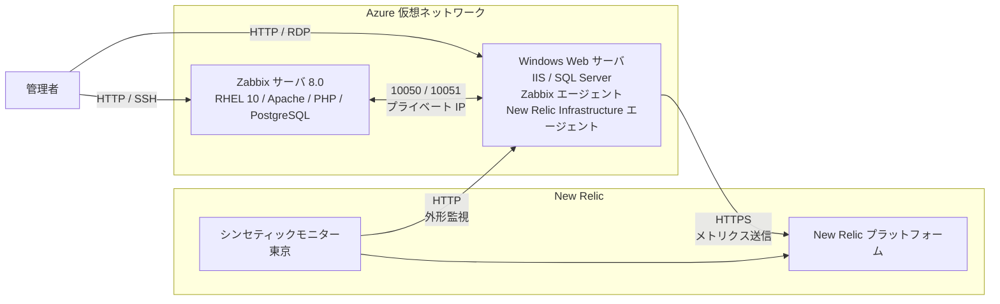

# Integrated_Monitoring_Platform

Zabbix と New Relic を組み合わせた統合監視プラットフォームの検証環境を、Azure 上に構築する Terraform コードです。

1 台の Windows Web サーバを、次の 2 つの方法で同時に監視します。

- **Zabbix（セルフホスト）**: Azure 上に自前で構築した Zabbix サーバが、同じ仮想ネットワーク内からサーバの状態を監視します。
- **New Relic（SaaS）**: Infrastructure エージェントでサーバの状態を収集し、シンセティックモニターで外部から Web サイトの応答を確認します。

内部からの監視と外部からの監視を組み合わせることで、「サーバは正常だが外部から Web サイトに接続できない」といった状況も切り分けられます。

> [!NOTE]
> `terraform validate` とモックによる `terraform test` は確認済みですが、Azure / New Relic への実デプロイは未検証です。

## 全体構成



## ディレクトリ構成

| ディレクトリ | 内容 | 主なリソース |
|---|---|---|
| [zabbix_server](zabbix_server/) | Zabbix サーバ 8.0 | RHEL 10 VM、Apache、PHP、PostgreSQL、PostgreSQL 用データディスク、VNet |
| [windows_web](windows_web/) | 監視対象の Web サーバ | Windows Server 2022 VM、IIS、SQL Server 2022 Developer、Zabbix エージェント、専用サブネット |
| [newrelic_monitoring](newrelic_monitoring/) | `windows_web` の New Relic 監視 | Infrastructure エージェント、シンセティックモニター、監視元からの HTTP を許可する NSG ルール |

各ディレクトリは独立した Terraform 構成で、state も別々です。後の構成は、前の構成で作成したリソースを名前で参照します。

- `windows_web` は `zabbix_server` の VNet と NIC を参照します。
- `newrelic_monitoring` は `windows_web` の VM、パブリック IP、NSG を参照します。

## 監視内容

| 観点 | Zabbix | New Relic |
|---|---|---|
| 監視の視点 | VNet 内部 | エージェント + インターネット経由の外形監視 |
| OS（CPU、メモリ、ディスクなど） | Zabbix エージェント + `Windows by Zabbix agent` テンプレート | Infrastructure エージェント |
| Web サイトの応答 | — | シンセティックモニター（`SIMPLE` タイプ、既定は 5 分間隔） |
| 監視データの保存先 | Azure 上の PostgreSQL | New Relic |
| 設定方法 | ホスト登録は Zabbix の画面で手動 | Terraform で自動 |

現在の範囲に含まれないものは次のとおりです。

- Zabbix と New Relic の間のデータ連携、および単一画面への集約
- IIS と SQL Server 専用の監視（Zabbix テンプレートや New Relic の連携機能）
- New Relic のアラートポリシー、Zabbix の通知設定

## 通信経路

| 送信元 | 宛先 | ポート | 用途 |
|---|---|---|---|
| `allowed_cidrs` | Zabbix サーバ | 22 / 80 | SSH、Zabbix 画面 |
| `allowed_cidrs` | Windows Web サーバ | 3389 / 80 | RDP、IIS |
| Zabbix サーバ | Windows Web サーバ | 10050 | パッシブチェック（VNet 内） |
| Windows Web サーバ | Zabbix サーバ | 10051 | アクティブチェック（VNet 内） |
| Windows Web サーバ | New Relic | 443 | メトリクス送信 |
| New Relic 東京の監視元 IP | Windows Web サーバ | 80 | シンセティックモニター |

SQL Server の 1433 番ポートは外部に公開していません。

## 前提条件

- Terraform 1.9 以上
- Azure CLI（`az login` 済みであること）
- SSH 鍵ペア（`zabbix_server` で使用）
- New Relic のアカウント ID、ユーザーキー、ライセンスキー（`newrelic_monitoring` で使用）

## 構築と削除

構成間に依存関係があるため、次の順番で実行してください。手順の詳細は各ディレクトリの README に記載しています。

| 順番 | 構築 | 削除 |
|---|---|---|
| 1 | [zabbix_server](zabbix_server/) | [newrelic_monitoring](newrelic_monitoring/) |
| 2 | [windows_web](windows_web/) | [windows_web](windows_web/) |
| 3 | [newrelic_monitoring](newrelic_monitoring/) | [zabbix_server](zabbix_server/) |

各ディレクトリでは、基本的に次のコマンドを実行します。

```bash
cp terraform.tfvars.example terraform.tfvars   # 値を編集する
terraform init
terraform apply
```

`windows_web` の構築後は、Zabbix の画面で監視対象のホストを登録してください。

## 注意事項

- 検証環境を想定した構成です。Zabbix の画面と Windows の Web は HTTP のみで、冗長化はしていません。
- SQL Server は開発・テスト専用の Developer エディションです。
- `terraform.tfvars` と `terraform.tfstate` にはパスワードや API キーが含まれます。Git には含めず、共有しないでください。
- Azure の VM、ディスク、パブリック IP に加え、RHEL のライセンス料が課金されます。使い終わったら削除してください。
